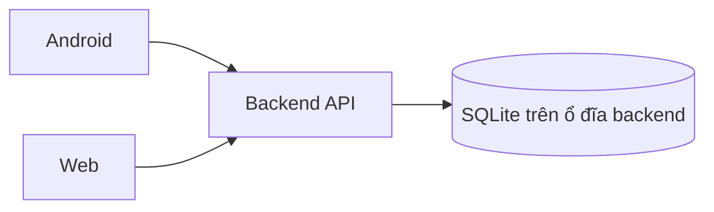
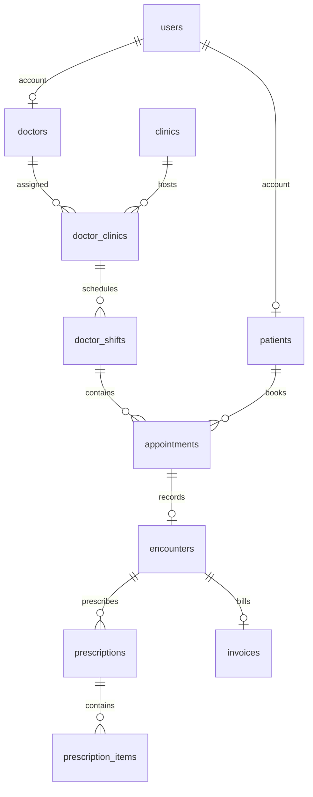
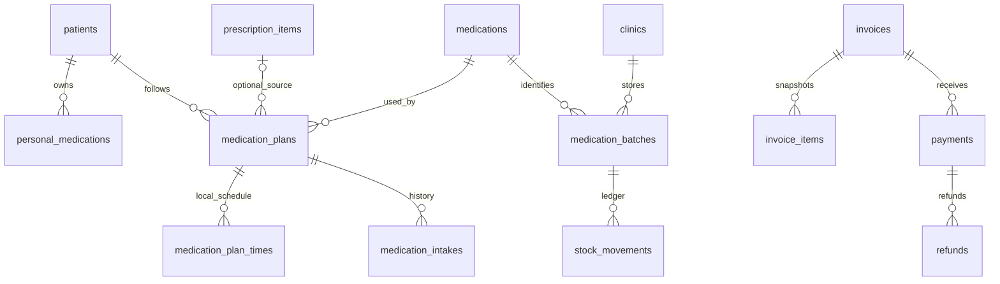

# Thiết kế database MediCare — SQLite

Schema phiên bản **2** gồm **34 bảng nghiệp vụ**, một bảng quản lý migration và hai view tính toán.
Bao quát quản lý khám ngoại trú và thuốc cá nhân trong một hệ thống có nhiều cơ sở.

## Kiến trúc dữ liệu dùng chung

Backend sở hữu database chuẩn. Android/web gọi API để đọc và cập nhật cùng nguồn dữ liệu;
không chia sẻ trực tiếp tệp SQLite qua mạng. Database cục bộ trên Android, nếu bổ sung,
sẽ là cache riêng và cần thiết kế đồng bộ sau.

## Các nhóm bảng

| Nhóm | Bảng |
| --- | --- |
| Tài khoản, phân quyền | `users`, `roles`, `user_roles`, `refresh_sessions` |
| Hồ sơ bệnh nhân | `patients`, `patient_allergies` |
| Cơ sở, bác sĩ | `clinics`, `specialties`, `doctors`, `doctor_specialties`, `doctor_clinics` |
| Lịch khám | `doctor_shifts`, `appointments` |
| Khám và chỉ định | `encounters`, `diagnosis_catalog`, `encounter_diagnoses`, `observations`, `services`, `service_orders` |
| Danh mục, đơn thuốc | `medications`, `prescriptions`, `prescription_items` |
| Thuốc cá nhân | `personal_medications`, `medication_plans`, `medication_plan_times`, `medication_intakes` |
| Kho thuốc | `medication_batches`, `stock_movements` |
| Hóa đơn và thanh toán | `invoices`, `invoice_items`, `payments`, `refunds` |
| Hỗ trợ | `notifications`, `audit_logs` |
| Kỹ thuật | `schema_migrations` |

## Quan hệ chính

[ERD đầy đủ với mọi khóa ngoại](erd.mmd) · [Từ điển mọi cột, kiểu dữ liệu và index](data-dictionary.md).

## Các ràng buộc được database thực thi

- **Tài khoản**: email không trùng khi khác hoa/thường; bệnh nhân có thể chưa có tài khoản;
  vai trò nhiều-nhiều. Tài khoản active cần có trường password_hash; thuật toán hash do backend kiểm tra.
- **Lịch khám**: ca làm không chồng giờ cùng bác sĩ, kể cả khác cơ sở. Lịch hẹn phải nằm
  trong ca scheduled; bác sĩ và bệnh nhân không có hai lịch hẹn chồng nhau. Khoảng thời gian
  `[bắt đầu, kết thúc)` cho phép hai lịch liền nhau. Tất cả trạng thái ngoài cancelled giữ
  khoảng giờ; cancelled giải phóng thời gian. Kiểm tra cả INSERT, UPDATE và tái kích hoạt.
- **Bảo vệ quan hệ cha**: không đổi phân công đã có ca, không đổi giờ/phân công ca đã có lịch,
  không đổi bệnh nhân/giờ/bác sĩ của lịch đã có lượt khám. Đổi lịch trước khám là UPDATE
  appointment hợp lệ trong ca; đổi ca đã được tham chiếu cần tạo ca mới.
- **Hồ sơ khám**: encounter phải đúng bệnh nhân của appointment; đơn và dòng đơn phải đúng
  bệnh nhân. Chỉ định dịch vụ phải cùng cơ sở của lượt khám. Một lượt có nhiều chẩn đoán,
  tối đa một chẩn đoán chính; chỉ số có giá trị số hoặc chữ, không đồng thời cả hai.
- **Nhắc thuốc**: kế hoạch có thể độc lập đơn thuốc; nếu liên kết dòng đơn phải đúng bệnh nhân
  và thuốc. Ngày hợp lệ, giờ HH:MM, bitmask ngày trong tuần 1–127; không trùng bản ghi
  cùng kế hoạch/thời điểm uống. Bản ghi taken phải có taken_at và snapshot liều.
  Sau khi đã ghi nhận uống, không đổi bệnh nhân/thuốc/liều/múi giờ/ngày hiệu lực của kế hoạch;
  kết thúc/tạm dừng và tạo kế hoạch mới khi cần đổi phác đồ.
- **Định danh lịch sử**: không chuyển hồ sơ bác sĩ đã phân công sang tài khoản khác;
  không chuyển nguồn lượt khám/bệnh nhân của đơn thuốc hoặc đổi định danh dòng đã cấp thuốc.
  Đơn vị tồn kho của thuốc đã được sử dụng cũng được giữ nguyên.
- **Tồn kho**: lô theo cơ sở/thuốc/hạn dùng; stock_movements chỉ thêm mới, không sửa/xóa/thay
  bằng REPLACE. Tổng số lượng không âm. Dòng có liên kết đơn phải khớp thuốc và cơ sở.
  Nhập dương, xuất âm; điều chỉnh phải có lý do theo chính sách backend. Tủ thuốc cá nhân
  là dữ liệu riêng, không tự động trừ kho phòng khám.
- **Tài chính**: chỉ VND, INTEGER đồng, không dùng REAL cho tiền. Invoice bắt đầu draft,
  có ít nhất một dòng trước khi issued; không quay lại draft. Chỉ sửa chi tiết khi draft;
  tên/đơn giá là snapshot, không phụ thuộc giá danh mục sau này. Tổng tối đa 10^12 đồng,
  tối đa 1.000 dòng/hóa đơn; số lượng/đơn giá có giới hạn để tránh tràn số.
- **Thu/hoàn tiền**: chỉ thu cho issued, không vượt dư nợ; hoàn không vượt phiếu thu gốc.
  `invoice_balances` trừ hoàn tiền khỏi số đã thu. Phải hoàn hết trước khi void hóa đơn.
  Phiếu thu/hoàn là lịch sử chỉ thêm; request_key duy nhất hỗ trợ chống ghi trùng khi retry.
- **Nhật ký**: audit_logs chỉ thêm; notifications lưu hàng đợi/trạng thái. Backend phải chủ động
  ghi audit và chạy tác vụ gửi thông báo; schema không tự cung cấp các dịch vụ này.
- **Kiểu dữ liệu**: STRICT từ SQLite 3.37+, khóa ngoại bật cho từng kết nối, không xóa dây chuyền
  lịch sử lâm sàng/tài chính; dùng trạng thái disabled/is_active để ngừng tài khoản/danh mục.

`stock_balances` tính tồn từ sổ biến động. `invoice_balances` tính tổng, số đã thu ròng và dư nợ;
không duy trì cột tổng tiền hoặc tồn kho trùng lặp dễ sai lệch.

## Quy ước backend khi triển khai

1. Mỗi kết nối bật `foreign_keys=ON`, `recursive_triggers=ON`, `busy_timeout=5000` trước giao dịch.
   Dùng INSERT/UPDATE thông thường; không dùng OR REPLACE với dữ liệu nghiệp vụ.
2. Một tác vụ nhiều dòng như kê đơn/xuất kho/thu tiền/ghi audit phải trong cùng transaction.
   Giao dịch ghi ngắn; dùng BEGIN IMMEDIATE cho quy trình đọc-rồi-ghi. Retry toàn tác vụ
   có request_key khi gặp khóa. SQLite cho một writer tại một thời điểm.
3. Tool mặc định journal DELETE, synchronous FULL. Python hiện liên kết SQLite 3.50.4;
   chỉ đánh giá WAL sau khi dùng bản đã vá và thử nghiệm tải thực tế.
4. Xác thực IANA timezone và chuyển giờ địa phương thành UTC ở backend; quy định DST,
   thay đổi timezone và nhắc bù khi mất kết nối trước khi triển khai gửi nhắc thực tế.
5. Backend thực thi quyền theo vai trò/cơ sở/bệnh nhân, xác thực bác sĩ được phép khám/kê đơn,
   trạng thái nghiệp vụ và điều kiện đăng ký/đặt lịch. FK không thay thế authorization.
6. Dùng hash mật khẩu phù hợp và digest phiên, không ghi token/password vào log. Mã hóa
   ổ đĩa, quản lý khóa, sao lưu/khôi phục và chính sách truy cập do môi trường triển khai chịu trách nhiệm.
7. Kiểm tra thuốc hết hạn, quy tắc cấp phát, số lượng kê/đã cấp, phạm vi thuốc và quy trình
   đối soát cổng thanh toán ở tầng nghiệp vụ. Schema chỉ bảo đảm các quan hệ/số dư nêu trên.
8. Không sửa migration đã áp dụng; thêm phiên bản mới. Dùng migration có backup và bước
   chuyển dữ liệu cho thay đổi cấu trúc. Tool không có lệnh reset hoặc ghi đè database.

## Phạm vi tiếp theo cần đặc tả riêng

Đây là nền ngoại trú và quản lý thuốc cá nhân theo các nghiệp vụ đã trao đổi. Chưa mô tả đầy đủ
nội trú/giường bệnh, bảo hiểm, kết nối thiết bị xét nghiệm/PACS, mua hàng/nhà cung cấp,
kế toán, chữ ký/chốt và phiên bản bệnh án, đồng bộ offline. Chưa có backend API hoặc UI.
Các yêu cầu này cần bổ sung thực thể/quy trình sau khi có tài liệu nghiệp vụ tương ứng.

## Nguồn kỹ thuật

- [SQLite foreign keys](https://www.sqlite.org/foreignkeys.html)
- [STRICT tables](https://www.sqlite.org/stricttables.html)
- [Transactions](https://www.sqlite.org/lang_transaction.html)
- [WAL và các phiên bản đã vá](https://www.sqlite.org/wal.html)
- [Conflict resolution / REPLACE](https://www.sqlite.org/lang_conflict.html)
